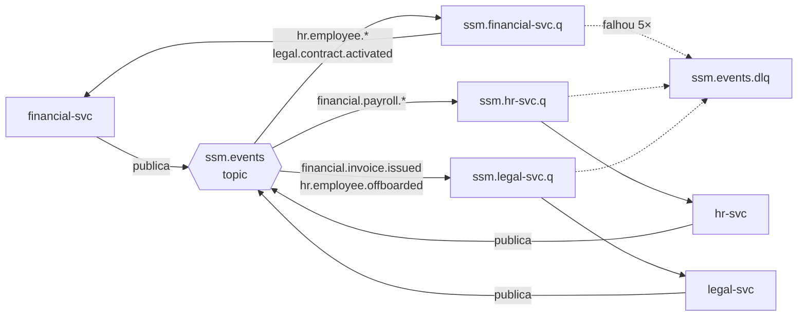
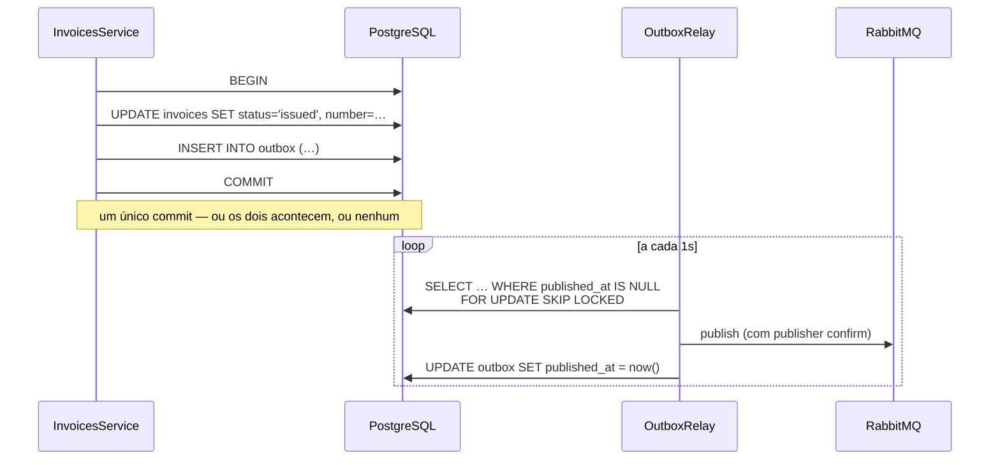

# Eventos

Os módulos não se chamam. Eles publicam fatos e reagem aos fatos dos outros.

## Topologia

Um único exchange do tipo `topic`, `ssm.events`. Cada serviço tem uma fila
durável `ssm.<serviço>.q` ligada aos padrões que lhe interessam.



Falhas passam por um anel de repetição antes da DLQ: a mensagem rejeitada vai
para `ssm.events.retry.q`, cuja TTL de 10s a devolve ao exchange principal. É
um atraso sem plugin de broker. Depois de 5 tentativas ela vai para a DLQ e
alguém precisa olhar.

## O envelope

Toda mensagem tem a mesma casca:

```jsonc
{
  "id": "uuid",              // único por publicação — consumidores deduplicam por ele
  "type": "financial.invoice.issued",
  "version": 1,              // major do schema de `data`
  "source": "financial-svc",
  "occurredAt": "2026-08-17T14:32:00-03:00",
  "tenantId": "uuid",
  "correlationId": "uuid",   // mesmo da requisição que originou a cadeia
  "causationId": "uuid",     // o evento que causou este, se houver
  "actorId": "uuid | null",
  "data": { }
}
```

`correlationId` é o que torna uma cadeia de cinco serviços legível: o consumidor
roda dentro do mesmo contexto do produtor, então um `grep` por um id devolve a
história inteira.

## Catálogo

Definido em `libs/contracts/src/events/catalog.ts`. Adicionar um evento ali é o
que o torna real — o schema Zod é usado tanto para validar na publicação quanto
no consumo.

| Evento | Publicado por | Consumido por | Quando |
|---|---|---|---|
| `financial.invoice.issued` | financial | legal | A fatura recebeu número e valores congelados |
| `financial.invoice.paid` | financial | — | O saldo chegou a zero |
| `financial.invoice.voided` | financial | — | A fatura foi cancelada com justificativa |
| `hr.employee.hired` | hr | financial | O onboarding foi concluído |
| `hr.employee.offboarded` | hr | financial, legal | O desligamento foi registrado |
| `legal.contract.activated` | legal | financial | O contrato entrou em vigência |
| `legal.contract.expiring` | legal | — | A vigência entrou na janela de aviso |

## As duas regras que não se negociam

**Consumidores são idempotentes.** A entrega é *at-least-once*: o mesmo evento
vai chegar duas vezes eventualmente, e o `envelope.id` existe para você
deduplicar. Um handler que credita um valor sem verificar se já processou aquele
id vai creditar duas vezes — não "talvez", vai.

**Publicação passa pelo outbox.** Escrever a linha e depois publicar são dois
commits sem transação entre eles. Uma queda no meio deixa o banco dizendo que a
fatura foi emitida enquanto ninguém a jusante ficou sabendo. O evento é gravado
na tabela `outbox` **dentro da mesma transação** da mudança de estado; o relay
publica depois.



`SKIP LOCKED` é o que permite rodar o relay em todas as réplicas: cada uma pega
um lote distinto. Sem ele, três pods brigariam pelas mesmas linhas.

## Compatibilidade

- Adicionar um campo a `data` é compatível — consumidores devem ignorar o que
  não conhecem.
- Remover ou renomear um campo, ou mudar o significado de um existente, **não
  é**. Incremente `version` e mantenha os dois durante a transição.
- Um consumidor que recebe uma `version` maior do que conhece deve rejeitar a
  mensagem, não adivinhar.
