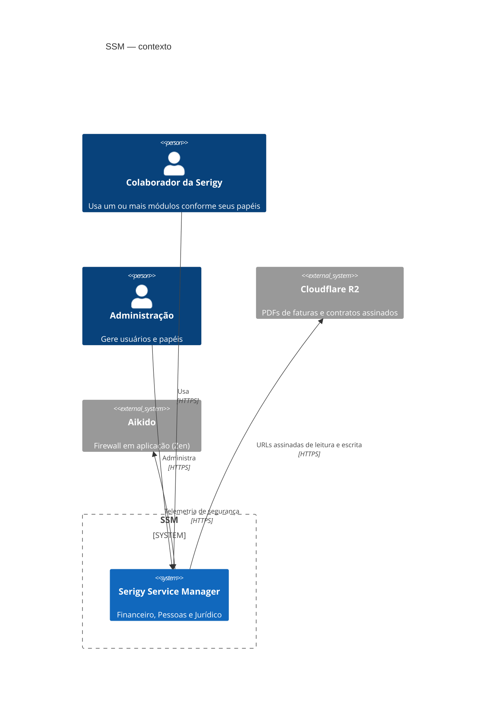
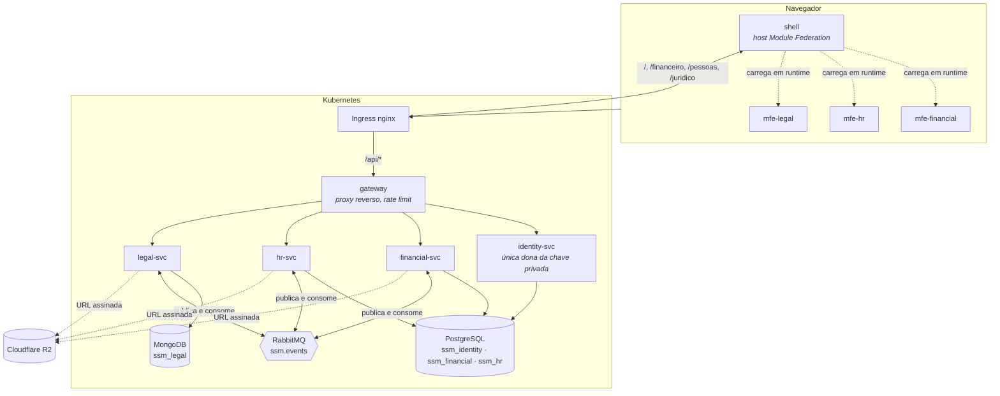

# Visão geral da arquitetura

## O problema que esta arquitetura resolve

O SSM atende três domínios com ritmos e donos diferentes. Financeiro muda quando
a legislação fiscal muda; Pessoas muda quando a política de RH muda; Jurídico
muda quando o modelo de contrato muda. Nenhum dos três precisa esperar os
outros — e é isso, e só isso, que justifica o custo de separá-los.

A separação vale em três camadas:

| Camada | Como se separa | O que isso compra |
|---|---|---|
| Dados | um banco por serviço | uma migração em um módulo não pode quebrar outro |
| Serviço | um processo por módulo | uma implantação por vez, e uma falha isolada |
| Interface | um bundle federado por módulo | o time do módulo publica a própria tela |

E o que ela custa: consistência entre módulos é eventual, não transacional.
Toda a assincronia do sistema existe para pagar esse preço de forma controlada
— ver [Eventos](eventos.md).

## Contexto



## Contêineres



Observe o que **não** existe nesse diagrama: nenhuma seta de `fin` para `hr`,
nem de `hr` para `leg`. Serviços de módulo não se chamam. A NetworkPolicy do
chart transforma essa regra de arquitetura em algo que o cluster recusa, em vez
de algo que a documentação pede.

## Fluxo de uma requisição

Uma listagem de faturas, do clique ao dado:

```mermaid
sequenceDiagram
  participant B as Navegador (mfe-financial)
  participant G as gateway
  participant F as financial-svc
  participant P as PostgreSQL

  B->>B: TokenStore.get() — renova se faltar < 60s para expirar
  B->>G: GET /api/financial/v1/invoices<br/>Authorization: Bearer …<br/>X-Correlation-Id: …
  G->>G: rate limit; remove x-tenant-id forjado
  G->>F: encaminha, preservando o correlation id
  F->>F: JwtAuthGuard verifica offline (RS256, chave pública)
  F->>F: PermissionsGuard exige financial:invoice:read
  F->>P: SELECT … WHERE tenant_id = $1 …
  P-->>F: linhas
  F-->>G: 200 application/json
  G-->>B: 200
```

Dois pontos merecem destaque:

**A verificação do token é offline.** Cada serviço tem a chave pública e valida
a assinatura localmente. Não há chamada ao identity-svc no caminho quente — o
identity-svc pode cair inteiro e as sessões já emitidas continuam funcionando
até expirarem.

**O `tenantId` vem do token.** O gateway remove `x-tenant-id`, `x-actor-id` e
`x-user-id` de toda requisição que passa por ele, exatamente para que nenhum
serviço possa ser induzido a confiar em um cabeçalho.

## Onde cada decisão está registrada

| Decisão | ADR |
|---|---|
| Monorepo com Nx | [0001](../adr/0001-monorepo-nx.md) |
| Microsserviços por módulo | [0002](../adr/0002-microsservicos-por-modulo.md) |
| Micro-frontends com Module Federation | [0003](../adr/0003-module-federation.md) |
| Postgres e MongoDB lado a lado | [0004](../adr/0004-postgres-e-mongodb.md) |
| Segredos em arquivo em vez de `.env` | [0005](../adr/0005-segredos-em-arquivo.md) |
| RabbitMQ com outbox transacional | [0006](../adr/0006-rabbitmq-e-outbox.md) |
| Gateway como proxy, não BFF | [0007](../adr/0007-gateway-como-proxy.md) |
| Zod como fonte única de esquema | [0008](../adr/0008-zod-como-contrato.md) |
| Aikido Zen como firewall em aplicação | [0009](../adr/0009-aikido-zen.md) |
