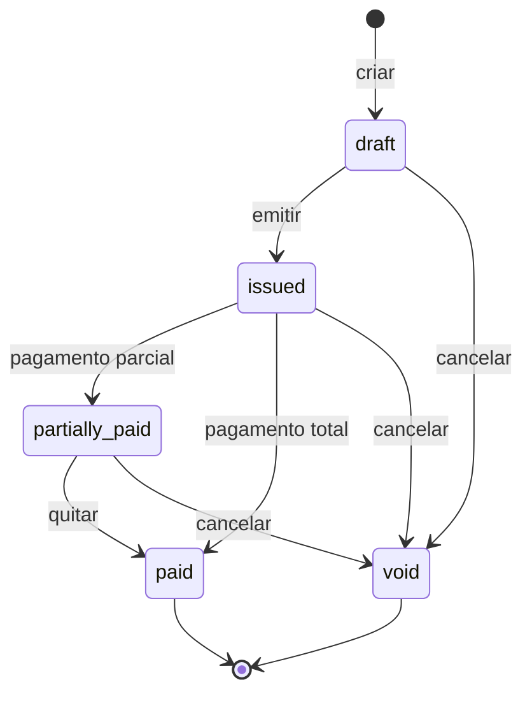

# Módulo Financeiro

`apps/financial-svc` · `apps/mfe-financial` · PostgreSQL `ssm_financial`

## Escopo

Faturamento e contas a receber. O que emite documento com número, valor e
vencimento.

Fora de escopo: contabilidade (o SSM não é ERP contábil) e conciliação bancária
(entra por integração, ainda não construída).

## Dinheiro é inteiro

Toda quantia trafega e é armazenada como **inteiro na menor unidade da moeda**
mais o código ISO-4217. R$ 12,34 é `{ amountMinor: 1234, currency: 'BRL' }`.

Nunca `float`, nunca `numeric`. E quantidade vai em milésimos —
`quantityMilli: 1500` é 1,5 unidade — para que a multiplicação também fique
inteira.

Toda a aritmética está em `src/invoices/money.ts` e em nenhum outro lugar.
Espalhar `Math.round` por um serviço é como dois endpoints passam a discordar em
um centavo, o que num módulo financeiro é falha de conciliação, não detalhe
estético.

Regra de arredondamento: **meio para cima, na linha, e só então soma**. As
linhas são o que aparece no documento impresso, então precisam ser os valores
que fecham a conta. O teste que garante isso é
`money.spec.ts › keeps the sum of line totals equal to the invoice total`.

## Estados



Transições ausentes são recusadas com 409, com a mensagem dizendo quais eram
possíveis. Não há caminho de volta de `issued` para `draft`: os valores de uma
fatura emitida são registro legal. Corrigir significa cancelar e emitir outra.

## Numeração sem buracos

A sequência é `FAT-<ano>-<5 dígitos>`, por tenant, atribuída na emissão.

Uma `SEQUENCE` do Postgres seria mais rápida, mas deixa buracos em rollback — e
em várias jurisdições um buraco na numeração fiscal é um achado de auditoria. A
implementação faz `SELECT ... FOR UPDATE` do último número, serializado pelo
lock de linha que a transação de emissão já mantém.

## Regras que o banco impõe

Constraints, não só código de aplicação — porque uma constraint vale contra um
`UPDATE` manual às três da manhã e o código não:

```sql
CHECK (amount_paid_minor BETWEEN 0 AND total_minor)
CHECK (status = 'draft' OR (number IS NOT NULL AND issue_date IS NOT NULL))
CHECK (quantity_milli > 0)
CHECK (tax_rate_bps BETWEEN 0 AND 10000)
```

## Concorrência

Registrar pagamento faz `SELECT ... FOR UPDATE`. Dois pagamentos simultâneos na
mesma fatura leriam ambos o `amountPaid` anterior, ambos somariam, e a segunda
escrita sobrescreveria a primeira — perdendo um pagamento. O lock pessimista é
o que impede isso.

## Eventos

**Publica:** `financial.invoice.issued`, `financial.invoice.paid`,
`financial.invoice.voided` — todos pelo outbox, na mesma transação da mudança.

**Consome:** `hr.employee.offboarded` (encerra cobranças recorrentes do
colaborador) e `legal.contract.activated` (habilita faturamento da contraparte).

## Permissões

| Permissão | Alcance |
|---|---|
| `financial:invoice:read` | Ler e listar |
| `financial:invoice:create` | Criar rascunho |
| `financial:invoice:update` | Editar rascunho, registrar pagamento |
| `financial:invoice:approve` | **Emitir e cancelar** |
| `financial:invoice:delete` | Excluir rascunho |
| `financial:report:export` | Exportações |

Emitir exige `approve`, não `update`: atribui número de documento legal e é
irreversível. Excluir só vale para rascunho — o que já foi emitido se cancela,
para que o número permaneça no histórico.

## Documentos

O PDF fica no R2. A API devolve uma URL assinada de curta duração; o arquivo
nunca passa pelo serviço.

## Pendente

- Renderização do PDF (hoje `documentKey` é sempre nulo)
- Notas de crédito
- Faturamento recorrente a partir de contrato
- Relatórios e exportação contábil
