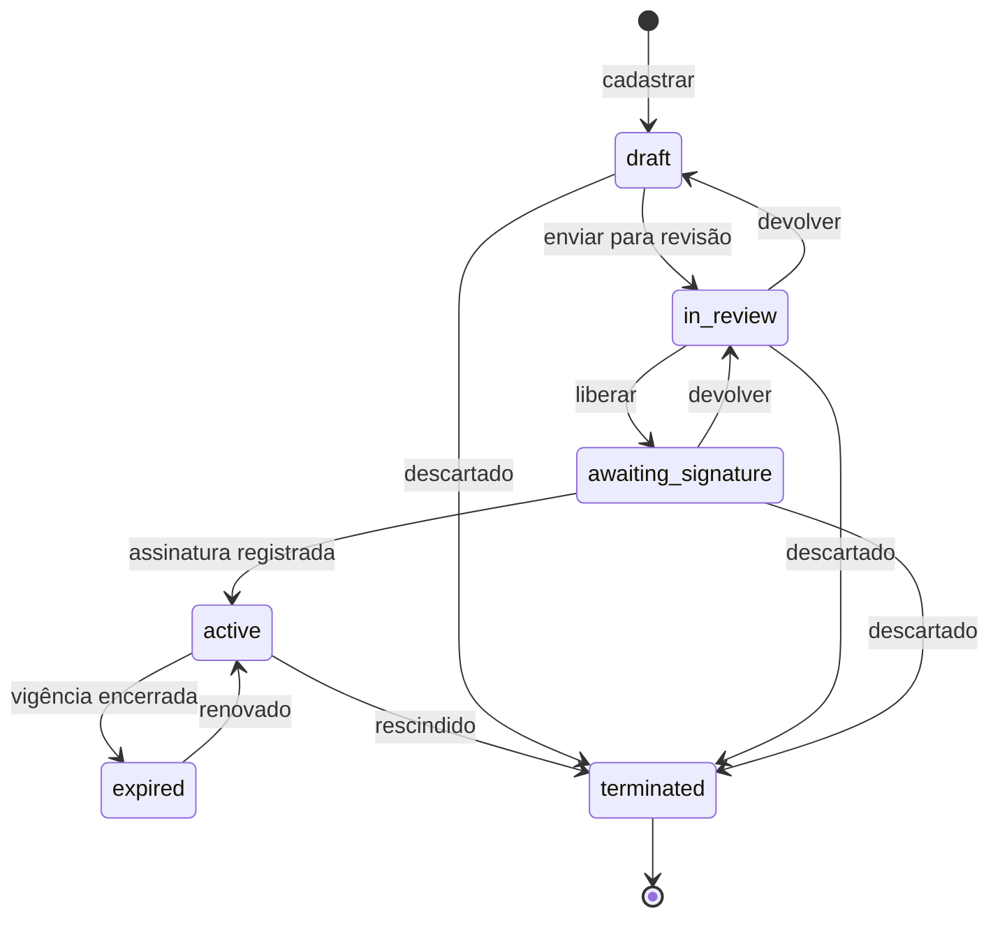
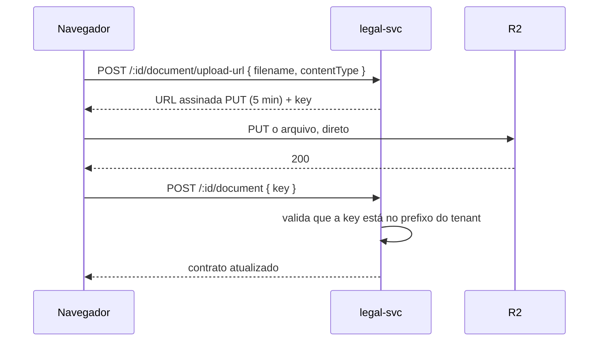

# Módulo Jurídico

`apps/legal-svc` · `apps/mfe-legal` · MongoDB `ssm_legal` · R2

## Escopo

Contratos, cláusulas, obrigações e vigências. O ciclo do rascunho ao
encerramento, com histórico completo de aditivos.

## Por que MongoDB aqui

Um contrato é uma árvore de cláusulas de profundidade arbitrária — 4.2.1.a
existe — e cada aditivo produz uma nova versão *completa* dessa árvore.

Nada aponta de fora para dentro da árvore de cláusulas. Não há integridade
referencial a proteger ali. O que precisa dela — quem é a contraparte, quanto se
cobra — está no Postgres sob o Financeiro, referenciado aqui só por id.

O raciocínio inteiro está no [ADR 0004](../adr/0004-postgres-e-mongodb.md).

## Estados



Ativar exige data de vigência inicial e ao menos uma parte, e publica
`legal.contract.activated`.

## Aditivos, não edições

Um contrato `active` ou `terminated` não aceita `PUT`. Alterar o texto é
registrar um aditivo: `POST /:id/amend` arquiva a árvore atual como versão e
grava a nova, incrementando `currentVersion`.

O histórico guarda **snapshots completos**, não diffs. Reconstruir "o que dizia a
cláusula 7.3 na data da assinatura" é uma leitura, não um replay de cadeia.
Armazenamento é barato; a alternativa não é.

## Avisos de vencimento

`ExpiryScheduler` varre de hora em hora os contratos ativos cuja vigência entrou
na janela de aviso (`renewalNoticeDays`, padrão 30) e publica
`legal.contract.expiring`.

Roda em todas as réplicas. O que torna isso seguro é o campo
`expiryNoticeSentFor`, atualizado por escrita condicional: exatamente uma réplica
ganha e publica. E como o guarda armazena a data de fim, uma renovação que mova
essa data rearma o aviso automaticamente.

A tela "Vencimentos" lê o **mesmo endpoint** que alimenta esse aviso. É
deliberado: o que o advogado vê na tela e o que chega na caixa de entrada não
podem divergir.

## Documentos

O PDF assinado nunca passa pelo serviço:



A validação do passo final importa: sem ela, um chamador poderia anexar a chave
de um documento de outro tenant ao próprio contrato.

## Índices

```js
{ tenantId: 1, id: 1 }                        // único
{ tenantId: 1, reference: 1 }                 // único
{ tenantId: 1, status: 1, effectiveTo: 1 }    // listagem filtrada
{ tenantId: 1, effectiveTo: 1 }               // esparso — a varredura de vencimento
{ title, reference, 'parties.name' }          // texto, com pesos
```

O índice de texto pesa `reference` em 10, `title` em 5 e nome de parte em 1 —
quem busca "SER-2026" quer a referência, não um contrato que a menciona.

## Durabilidade

A conexão usa `writeConcern: { w: 'majority', j: true }`. Um contrato que
"salvou" e sumiu num failover não é aceitável em registro jurídico. Custa
latência de escrita; vale.

## Eventos

**Publica:** `legal.contract.activated`, `legal.contract.expiring`.

**Consome:** `hr.employee.offboarded` (marca para revisão os contratos em que a
pessoa figura como parte ou responsável por obrigação) e
`financial.invoice.issued`.

O primeiro é a reconciliação que substitui a integridade referencial que o Mongo
não oferece: um `externalRef` pode apontar para um colaborador que saiu, e a
resposta é sinalizar para revisão humana, não impedir a escrita.

## Permissões

| Permissão | Alcance |
|---|---|
| `legal:contract:read` | Ler, listar, vencimentos |
| `legal:contract:create` | Cadastrar |
| `legal:contract:update` | Editar rascunho, aditivar, anexar |
| `legal:contract:approve` | **Mudar de estado**, inclusive ativar |
| `legal:contract:delete` | Descartar |

## Pendente

- Extração de cláusulas do PDF (hoje entram manualmente)
- Classificação de risco assistida
- Painel de obrigações com prazos
- Comparação entre duas versões
