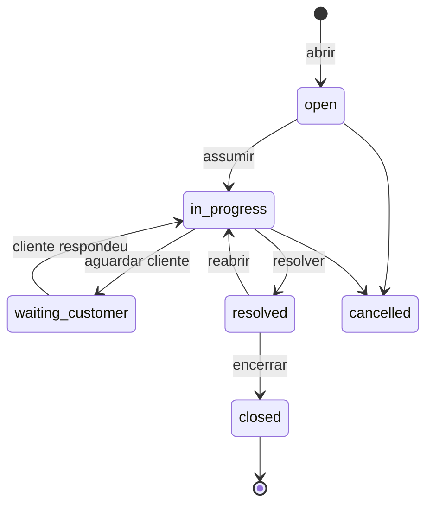

# Módulo Operações

`apps/ops-svc` · `apps/mfe-operations` · PostgreSQL `ssm_operations`

## Escopo

Sustentação: o inventário de ambientes que a Serigy mantém no ar, os chamados
sobre eles, e a apuração mensal de disponibilidade contra o que o contrato
promete.

É o módulo que fecha o ciclo do negócio. O Jurídico registra o compromisso
("disponibilidade mensal mínima de 99,5%"), Operações mede o mês contra ele, e o
Financeiro credita o cliente quando o compromisso não foi cumprido.

## O ambiente é a âncora

Tudo aqui pende de um ambiente. Um chamado é sobre um ambiente, um SLA é apurado
por ambiente, e o contrato que define esse SLA nomeia ambientes. Modelar chamados
sem eles deixaria o compromisso contratual sem nada a que se prender.

Estados, e por que são estados e não sinalizadores:

| Estado | O que significa |
|---|---|
| `operational` | nada errado |
| `incident` | algo quebrado agora, com o relógio do SLA correndo |
| `scheduled_window` | manutenção planejada — indisponibilidade que **não** conta |
| `decommissioned` | fora de sustentação, mantido para histórico |

`scheduled_window` é o que separa trabalho planejado de descumprimento. Por isso
a janela é declarada antes, e por isso um ambiente em incidente **recusa**
agendamento: aceitar tiraria da apuração uma indisponibilidade que já está
acontecendo.

## Chamados

Severidade não é rótulo de prioridade escolhido por sensação — é valor
contratual, porque dela sai o prazo:

| | Significado | Prazo padrão |
|---|---|---|
| `sev1` | serviço parado ou perda de dados | 15 min |
| `sev2` | degradação com impacto em produção | 60 min |
| `sev3` | demais solicitações | 8 h |

O prazo real vem do ambiente, que o herda do contrato.

Três decisões que valem entender:

**A primeira saída de `open` é a primeira resposta.** Registrada ali, não por
alguém clicando em "respondi" — assim o número que vai para a apuração é o que
aconteceu, não o que alguém lembrou.

**`waiting_customer` pausa o relógio, e só ele.** Não é alcançável a partir de
`open`, de propósito: senão um chamado poderia estacionar antes de qualquer
pessoa tê-lo olhado, que é exatamente o abuso que o SLA existe para impedir.

**Um `sev1` coloca o ambiente em incidente, e resolvê-lo o devolve** — mas só
se não houver outro `sev1` aberto no mesmo ambiente. Duas coisas quebradas ao
mesmo tempo continuam sendo um ambiente quebrado.

O `BreachScanner` marca os prazos vencidos a cada minuto. Sem ele, um chamado
esquecido pareceria em dia até o instante em que fosse finalmente respondido, e
a apuração do mês subestimaria o descumprimento.

## Apuração de SLA

A indisponibilidade é **derivada dos chamados sev1**, não digitada. Um número
informado à mão é um número do qual se pode ser convencido; um número derivado
do registro de incidentes tem trilha por trás.

Três regras no cálculo:

- Incidentes sobrepostos são fundidos. Duas coisas quebradas ao mesmo tempo
  foram uma indisponibilidade para o cliente, e contar duas vezes inflaria o
  crédito — ele estaria certo em contestar.
- O tempo aguardando o cliente é descontado.
- Janelas agendadas saem do **denominador**, não entram como indisponibilidade.

O desconto segue a regra do contrato semeado: 5% da mensalidade a cada 0,5%
abaixo da meta, limitado a 20%. A função vive em `@ssm/contracts`, não no
serviço — Operações calcula e o Financeiro aplica, e uma segunda implementação
acabaria discordando por um valor que aparece na fatura de um cliente.

**A apuração é gravada uma vez.** Reexecutar devolve o resultado guardado. Ela
vira crédito numa fatura que o cliente já viu, e prova que muda quando se olha de
novo não é prova.

## Eventos

**Publica:** `operations.incident.opened`, `operations.incident.resolved`,
`operations.environment.provisioned`, `operations.sla.breached`.

`operations.sla.breached` é o evento que atravessa o sistema inteiro — é o único
em que três módulos participam de uma mesma decisão.

**Consome:** `legal.contract.activated` e `legal.contract.expiring` (a meta e a
cobertura vêm do contrato), `hr.employee.offboarded` (um chamado atribuído a quem
saiu é um chamado que ninguém está atendendo, e o relógio não sabe disso).

Nenhuma dessas referências é chave estrangeira: os registros vivem nos bancos de
outros serviços. Os eventos são como a lacuna é notada e colocada diante de uma
pessoa.

## Permissões

| Permissão | Alcance |
|---|---|
| `operations:environment:read` | Ver o inventário |
| `operations:environment:create` / `update` | Provisionar, agendar janela |
| `operations:ticket:read` / `create` / `update` | Operar a fila |
| `operations:sla:read` | Ver as apurações |
| `operations:sla:approve` | **Apurar um mês** |

Apurar exige `approve` e não `update`: o resultado vira crédito na fatura do
cliente. O papel `operations:oncall` — o plantão — abre, atende e resolve
chamados, mas não provisiona ambiente, não renegocia meta e não fecha um mês.
São decisões com peso contratual, tomadas acordado.

## Numeração

Chamados são `#4801` em diante, sequenciais por cliente e nunca reutilizados.
A alocação usa trava consultiva por cliente (`pg_advisory_xact_lock`), não trava
de linha: travar a linha de maior número não protege nada quando a tabela está
vazia, e os dois primeiros chamados concorrentes de um cliente colidiriam.

## Pendente

- Escala de plantão (a atribuição existe; a escala não)
- Vínculo automático entre contrato e ambientes ao ativar o contrato
- Anexos e runbooks nos chamados
- Coleta automática de disponibilidade por monitoramento, em vez de derivar
  apenas dos chamados
- Nota de crédito no Financeiro a partir de `operations.sla.breached`
