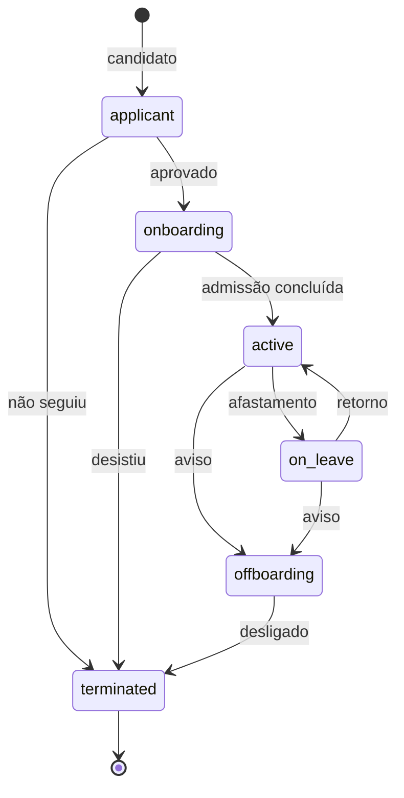

# Módulo Pessoas (HR)

`apps/hr-svc` · `apps/mfe-hr` · PostgreSQL `ssm_hr`

## Escopo

Cadastro de colaboradores, estrutura organizacional e ciclo de vida do vínculo.

Fora de escopo por ora: cálculo de folha, ponto, avaliação de desempenho.

## Este módulo é o de maior risco de privacidade

É onde estão CPF, data de nascimento, endereço e salário. Toda decisão de
desenho aqui parte disso.

### Projeção por permissão

Sem `hr:payroll:read`, a resposta **omite** os campos sensíveis — eles não vêm
`null`, vêm ausentes. É `employeeSafeSchema` em `libs/contracts`.

A diferença importa: `null` é indistinguível de "esse colaborador não tem salário
cadastrado". A ausência do campo é uma afirmação diferente, e um cliente
consegue distinguir as duas.

### CPF cifrado no banco

`national_id_enc` é `bytea`, cifrado com `pgp_sym_decrypt`/`pgp_sym_encrypt` do
pgcrypto. A chave está em `/run/secrets/pii_encryption_key`, montada **só** no
hr-svc.

A decifragem acontece dentro da consulta SQL. A chave não viaja até o Node e o
texto claro nunca fica em uma variável que possa aparecer em um dump de heap.

Listagens nunca decifram — só `findOne`, e só com permissão.

### Colaborador não se exclui

Não existe `DELETE`. Um desligamento muda o estado para `terminated` e registra
`end_date`. O histórico é exigência trabalhista, e o registro precisa sobreviver
por décadas.

## Estados



`active` exige a transição explícita `POST /:id/activate`, que publica
`hr.employee.hired`. Onboarding concluído é um fato com consequências em outros
módulos, não uma edição de campo.

## Regras no banco

```sql
CHECK ((salary_minor IS NULL) = (salary_currency IS NULL))
CHECK (status <> 'terminated' OR end_date IS NOT NULL)
CHECK (end_date IS NULL OR end_date >= start_date)
UNIQUE (tenant_id, lower(work_email))
UNIQUE (tenant_id, employee_number)
```

O e-mail é único por *lower(email)*: "Ana@x.com" e "ana@x.com" são a mesma
pessoa.

## Matrícula

`COL-00001`, sequencial por tenant, **nunca reutilizada** — o histórico de folha
se refere a ela, e reciclar um número corromperia registros antigos.

## Eventos

**Publica:** `hr.employee.hired`, `hr.employee.offboarded`.

`hr.employee.offboarded` é o evento mais consequente do sistema: o Financeiro
encerra cobranças recorrentes; o Jurídico marca para revisão os contratos em que
a pessoa figura.

Nenhum dos dois carrega PII. Só `employeeId`, datas e motivo — um evento é lido
por serviços sem permissão para os campos sensíveis, e fica retido no broker.

**Consome:** `financial.payroll.*`.

## Permissões

| Permissão | Alcance |
|---|---|
| `hr:employee:read` | Ler, com a projeção reduzida |
| `hr:employee:create` | Cadastrar |
| `hr:employee:update` | Editar, concluir admissão |
| `hr:employee:delete` | **Registrar desligamento** (não exclui) |
| `hr:payroll:read` | **Ver salário e dado pessoal** |
| `hr:payroll:approve` | Aprovar folha |

## Pendente

- Estrutura organizacional na interface (a entidade existe, a tela não)
- Anexos de documentos do colaborador
- Job de anonimização ao fim do prazo de retenção
- Vínculo automático com `identity-svc` na admissão
