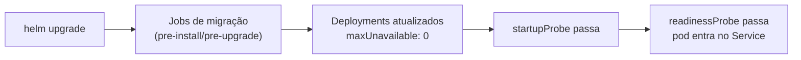

# Implantação

## No kind, na sua máquina

```bash
make kind-up      # cria o cluster e instala ingress-nginx e metrics-server
make deploy       # constrói as imagens, carrega no kind, aplica o Helm
```

Adicione ao `/etc/hosts`, uma vez:

```
127.0.0.1  ssm.localhost
```

Depois, `http://ssm.localhost`.

`make deploy` encadeia três coisas que valem entender:

1. `make images` constrói tudo — e as imagens de front-end são construídas com
   `PUBLIC_PATH` **explícito**, porque o `remoteEntry.js` resolve os chunks
   irmãos relativos a esse caminho;
2. `kind load docker-image` injeta as imagens no cluster, sem registry;
3. `make k8s-secrets` cria o Secret `ssm-secrets` a partir de `secrets/local/`
   — arquivo a arquivo, com os mesmos nomes.

Esse último ponto é o que faz a aplicação não perceber diferença entre o compose
e o Kubernetes: nos dois casos ela lê `/run/secrets/<nome>`.

## O que a instalação faz, na ordem



As migrações rodam como hook do Helm, antes dos Deployments. O schema é sempre
pelo menos tão novo quanto o código que vai rodar contra ele. Se uma migração
falhar, a implantação para ali e nenhum pod novo sobe.

`maxUnavailable: 0` e `maxSurge: 1` significam que capacidade nunca é retirada
antes de ser adicionada.

## Migrações que não podem ser revertidas

Na prática, um `DROP COLUMN` não volta — os dados se foram. Toda mudança
destrutiva usa expand-contract:

1. **Expandir.** Adicione a coluna nova. Implante o código que escreve nas duas
   e lê da antiga.
2. **Migrar.** Preencha a coluna nova. Implante o código que lê da nova.
3. **Contrair.** Só então remova a antiga, em uma implantação separada.

Cada passo é reversível sozinho. Fazer os três de uma vez não é.

## Verificar

```bash
make k8s-status
kubectl -n ssm logs -l app.kubernetes.io/component=gateway -f
curl -s http://ssm.localhost/api/v1/status | jq
```

`/api/v1/status` consulta o `/health/ready` de cada módulo. É o primeiro lugar a
olhar.

## As três sondas

Confundi-las é como um cluster acaba reiniciando pods saudáveis durante um
incidente de banco.

| Sonda | Pergunta | Falha significa |
|---|---|---|
| `/health/live` | o processo travou? | **o contêiner é morto** |
| `/health/ready` | dá para atender agora? | o pod sai do Service |
| `/health/startup` | terminou de subir? | dá tempo à inicialização |

`live` **nunca** consulta dependência. Se o Postgres cair e a liveness falhar,
o Kubernetes reinicia todos os pods — o que não conserta o Postgres e destrói
qualquer chance de as conexões se recuperarem sozinhas.

## Reverter

```bash
helm rollback ssm -n ssm            # versão anterior
helm history ssm -n ssm             # o que existe
```

Reverter o chart **não** reverte a migração. Se a implantação que falhou incluía
uma mudança de schema, avalie se o código anterior funciona contra o schema novo
antes de reverter — com expand-contract, funciona.

## Staging e produção

Não use `make deploy`. O pipeline publica as imagens no registry e roda:

```bash
helm upgrade --install ssm deploy/helm/ssm \
  --namespace ssm \
  --values deploy/helm/ssm/values.yaml \
  --set image.tag="$GIT_SHA" \
  --wait --timeout 10m
```

Diferenças que importam nesses ambientes:

- os datastores empacotados ficam **desligados**; apontam para serviços gerenciados;
- `ZEN_BLOCKING` é `true`;
- `ssm-secrets` vem do External Secrets Operator, não de `secrets/local/`;
- as NetworkPolicies são aplicadas (a CNI padrão do kind não as aplica).
