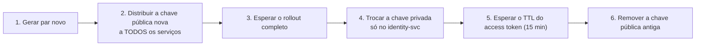

# Rotação de segredos

## Quando rotacionar

- Alguém com acesso saiu da equipe.
- Um segredo apareceu em log, ticket, captura de tela ou mensagem.
- Rotina: chaves de API a cada 90 dias, par de assinatura JWT a cada 180.
- Imediatamente, em qualquer suspeita de comprometimento.

## Desenvolvimento

```bash
./scripts/gen-secrets.sh --force
make down && make dev
```

Regenerar o par de chaves **invalida todos os tokens já emitidos**. Todo mundo
precisa entrar de novo. Em desenvolvimento isso é irrelevante; em produção é o
que define a janela de manutenção.

## Produção, por tipo

### Senha de banco

Postgres aceita duas senhas para o mesmo papel só durante a troca, então:

1. Crie um papel novo com a senha nova e os mesmos privilégios.
2. Atualize o segredo (no Vault; o External Secrets Operator sincroniza).
3. Os pods reiniciam sozinhos — o `checksum/secret` no template do Deployment
   muda quando o Secret muda, e isso é o gatilho.
4. Confirme que ninguém mais usa o papel antigo: `pg_stat_activity`.
5. Só então remova o papel antigo.

Não altere a senha do papel em uso: as conexões existentes continuam válidas,
mas qualquer reconexão falha, e a falha aparece minutos depois de forma difusa.

### Par de chaves JWT

Este é o único que precisa de coreografia, porque a assinatura é verificada
offline por todos os serviços.



O passo 3 não pode ser pulado. Se o identity-svc passar a assinar com a chave
nova antes de todos os serviços conhecerem a pública correspondente, **toda
requisição autenticada devolve 401** até o rollout terminar.

Suporte a duas chaves públicas simultâneas ainda não existe no `JwtService` —
ele carrega uma. Até que exista, esta rotação exige janela de manutenção. Está
anotado como dívida em `docs/security/README.md`.

### Chave de criptografia de PII (`pii_encryption_key`)

A mais cara. A coluna `national_id_enc` está cifrada com ela; trocar a chave sem
recifrar torna o dado ilegível — permanentemente.

1. Coloque o hr-svc em modo somente leitura (escale o Deployment para 0 e sirva
   um aviso, ou use um feature flag).
2. Rode o job de recifragem: lê com a chave antiga, escreve com a nova, em
   lotes, dentro de uma transação por lote.
3. Verifique a contagem de linhas recifradas contra o total.
4. Troque o segredo e volte a escalar.

Faça em homologação primeiro, com um dump restaurado de produção. Sempre.

### Credenciais de R2

1. Crie um token novo no painel da Cloudflare, com as mesmas permissões.
2. Atualize o segredo; os pods reiniciam.
3. Confirme upload e download pela interface.
4. Revogue o token antigo — só depois de confirmar.

URLs assinadas já emitidas continuam válidas até expirarem (2 a 5 minutos). Se a
rotação for por comprometimento, revogue imediatamente e aceite os erros nesses
poucos minutos.

## Depois de qualquer rotação

```bash
make secrets-check                     # nada sensível rastreado pelo git
curl -s https://ssm.serigy.io/api/v1/status | jq
```

E confira nos logs se algum serviço está reclamando de segredo ausente — o
`SecretsService` falha alto e cedo, no boot, exatamente para isso ser visível.
