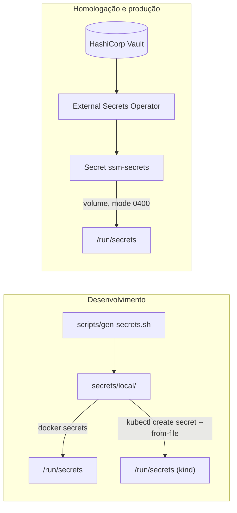

# Gestão de segredos

O *porquê* está no [ADR 0005](../adr/0005-segredos-em-arquivo.md); o *como usar*
está em [secrets/README.md](../../secrets/README.md). Aqui está de onde cada
segredo vem, em cada ambiente.

## Cadeia por ambiente

Os três caminhos terminam no mesmo lugar. A aplicação lê
`${SSM_SECRETS_DIR}/<nome>` e não sabe qual deles a alimentou.

## Inventário

| Segredo | Quem recebe | Rotação | Origem em produção |
|---|---|---|---|
| `postgres_password` | identity, financial, hr | 90 dias | Vault |
| `mongo_password` | legal | 90 dias | Vault |
| `rabbitmq_password` | todos | 90 dias | Vault |
| `jwt_private_key.pem` | **só identity-svc** | 180 dias | Vault |
| `jwt_public_key.pem` | todos | com a privada | Vault |
| `pii_encryption_key` | **só hr-svc** | anual, com recifragem | Vault |
| `r2_account_id` | financial, hr, legal | — | Vault |
| `r2_access_key_id` | financial, hr, legal | 90 dias | Vault |
| `r2_secret_access_key` | financial, hr, legal | 90 dias | Vault |
| `session_secret` | gateway | 90 dias | Vault |
| `aikido_token` | só CI | 180 dias | Segredo do GitHub Actions |

A coluna "quem recebe" é imposta, não sugerida: o `secretKeys` de cada serviço no
`values.yaml` vira uma lista `items` na projeção do volume, e o pod só monta
esses arquivos. Comprometer o financial-svc não dá acesso à chave privada de JWT
nem à chave de PII, porque elas não estão lá.

## Como isso é garantido

**No git.** Duas camadas de `.gitignore` (raiz e `secrets/.gitignore`), um job de
CI que falha se algo além dos templates estiver rastreado, e o Gitleaks
varrendo o histórico inteiro — um segredo commitado e depois removido continua
nos objetos e continua comprometido.

**Em execução.** Nenhum segredo em variável de ambiente. `SecretsService.require()`
falha no boot, alto, se faltar algo — melhor não subir do que subir degradado e
falhar na primeira requisição que precisar do valor.

**Em log.** Redação por nome de campo e por valor. Ver
[classificacao-de-dados.md](classificacao-de-dados.md).

**No Terraform.** Ele **não** cria segredos, de propósito: qualquer valor que
passe pelo Terraform vai para o arquivo de estado em texto claro, legível por
quem puder ler o bucket de estado.

## O que fazer se um segredo vazar

1. **Rotacione primeiro.** Investigue depois — enquanto você investiga, ele
   continua válido.
2. Siga [rotacao-de-segredos.md](../runbooks/rotacao-de-segredos.md) para o tipo.
3. Revogue a credencial antiga no provedor, não só no Vault.
4. Procure uso indevido nos logs, filtrando pelo período entre a exposição e a
   rotação.
5. Se o segredo esteve em um commit, ele está no histórico do git para sempre.
   Rotacionar é obrigatório; reescrever o histórico é opcional e não substitui a
   rotação.
